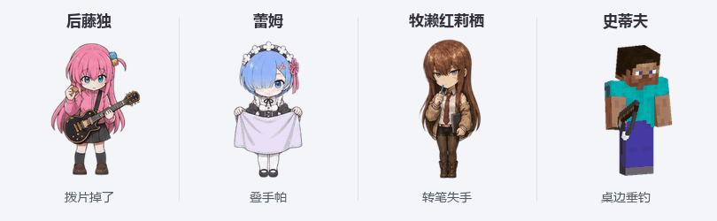
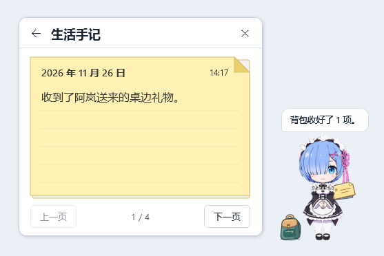
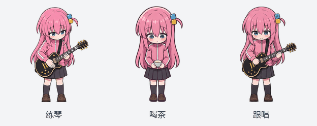

# 窗边手记

一个住在 Windows 桌面上的小伙伴。波奇的拨片会从指间滑落，蕾姆会把没对齐的手帕再折一次，红莉栖会伸手去接转飞的笔，史蒂夫有时会从桌边钓起一只皮靴。小人自己安排这些活动。遇到小盒子还可以猜宝，或者等它自己揭晓。



## 下载便携版

从发行页的 **Assets** 下载 Windows 便携 ZIP，解压到一个文件夹，双击 **窗边手记.exe**。首次启动会在桌面右下角看见蕾姆。右击小人打开 **伙伴设置**，可以换成牧濑红莉栖、史蒂夫或后藤独。[下载最新发行版](https://github.com/XiaoLiZiREAL/desk-atelier/releases/latest)

支持 Windows 10 1809 及以后版本和 Windows 11，需要 .NET Framework 4.8 或更新版本，无需 ChatGPT 账号。升级时先从托盘退出旧版，再启动新版。便签、角色设置和背包索引保存在 `%LOCALAPPDATA%\DeskAtelier`。

## 桌面工具

- **番茄钟**　在右键菜单中打开，按住圆环顺时针拖动增加时长，逆时针缩短。一圈 60 分钟，可设 1 至 180 分钟，也可以用滚轮微调。点「开始专注」后，收起卡片仍会计时。
- **听音乐**　右键菜单和托盘共用一个开关，首次默认开启。播放后小人会随歌动，有歌名时显示歌曲卡片，有当前歌词或带时间轴的同步歌词时逐句跟唱。关闭开关即可收起字幕并停止识别。
- **便签**　右击选择「便签」，直接在纸上写字，内容会自动保存。点右上折角翻页，按住 Shift 再点可翻回上一页。翻到空白页就能新写一张，每次翻页随机换为另一种纸色，有黄、红、蓝三种。左上图钉可以让便签一直浮在桌面上，右下垃圾桶可以删除当前页，并可撤销删除。
- **把便签交给小人**　写「半小时后出门」「拿快递，明天下午三点提醒我」或「下周一上午九点开会」，纸底会预览递回时间。点击「递给伙伴」或拖给小人，倒计时从交出时开始。「晚点提醒我」这样的便签会请你确认时刻。也可以随时点纸上的小钟选日期、时间或「只保管」。到点点击小人旁边的纸条能打开原页，也可以推迟十分钟。
- **随身背包与提醒**　把文件拖给小人，小背包就会出现。点开可访问文件、文件夹或收藏的网址，移出最后一项后背包收起。原文件留在原处。拖入一段文字会记成便签，拖入「10分钟后提醒我拿外卖」可以设置提醒。
- **礼物**　把房间布置和写给朋友的卡片打包为 `.deskpet`，也可以把收到的礼物文件拖给小人预览。




### 音乐来源

| 播放位置 | 桌宠能读取什么 |
| --- | --- |
| 汽水音乐、网易云音乐、QQ 音乐、酷狗、酷我、咪咕、洛雪音乐助手、YesPlayMusic 的 Windows 客户端 | 优先使用 Windows 公布的当前歌曲和进度，也会检查这些播放器公开的播放栏和歌词浮窗。只检测到播放器发声时，显示「汽水音乐正在播放音频」等来源提示。 |
| Chrome、Edge 中的网易云、QQ 音乐独立播放器、酷狗歌曲播放页、酷我、咪咕、千千音乐独立播放器和汽水音乐官方歌曲分享页 | 在可见标签核对官方站点、正在出声的标签和播放器控件。登录或试听权限沿用浏览器里已有的账号。 |
| 其他发布 Windows 媒体会话的程序和网页 | 可以跟随其提供的曲目信息和播放进度。浏览器仅提供音频活动时，显示「浏览器正在播放音频」。 |

汽水音乐可使用 Windows 客户端，也可在 Chrome 或 Edge 打开官方歌曲分享页试听。网页公开当前歌词时，小人会跟着这一行唱。试听可能从原曲中间开始，桌宠会采用网页提供的歌词。桌宠读取本机公开的播放状态和音量活动，无需录音。

网易云、酷我和汽水歌曲分享页的播放已经在 Windows Chrome 中验证。其他网页适配已核对官方播放器控件，并通过播放栏样本验收。汽水音乐已核对 Windows 3.7.0 官方包发布歌名、歌手的逻辑，并在独立测试进程上验证 Windows 的声音检测和暂停处理。客户端升级或网站调整后，能读到的信息可能变化。

多个标签同时发声时，Chrome 有时只向 Windows 报告其中一个。遇到桌宠跟到视频或直播，切回已经打开的网易云标签即可重新核对。再切走时，桌宠仍可跟随此前确认、仍在出声的同一首歌。后台换曲后若 Windows 仍在报告其他标签，需要再切回网易云一次。

部分播放器版本只公开曲名。可以开启播放器自己的桌面歌词，让桌宠读取公开的歌词文字。如果播放器提供播放进度，也可以在 Windows 的「音乐」文件夹中放入 **歌手 - 歌名.lrc**。升级用户之前指定的歌词目录、已导入的歌词和缓存仍可使用。在 **伙伴设置 → 歌词隐私** 中，可以分别允许或关闭联网匹配和本机歌词画面识别。联网匹配会向 LRCLIB 发送曲名、歌手和时长。画面识别只读取播放器的歌词浮窗。两项首次默认关闭，升级沿用已有选择。

## 从源码构建

在 Windows PowerShell 或 PowerShell 7 中，从仓库根目录运行下列命令。构建使用本机 .NET Framework C# 编译器和系统组件。

```powershell
.\src\build.ps1 -Output .\build\DeskAtelier.exe
.\build\DeskAtelier.exe
```

- `tests\run.ps1` 检查工具卡、便签、角色、背包、存档和拖放。`tests\run-dial.ps1` 检查表盘交互。
- `tests\run-paper-handoff.ps1` 检查时间识别、原纸交接、提醒、延期和退出后重新启动。加上 `-PhysicalPointer` 会短暂移动鼠标，实测从便签拖到小人身上。
- `tests\run-paper-time.ps1` 用固定日期检查中文时长、星期、日历日期、歧义和普通便签。`tests\Check-DomesticPlayers.ps1` 核对 Windows 播放器身份、曲目信息与暂停状态。
- `tests\run-life.ps1` 从空白测试存档观察角色自主活动和打断条件。`tests\run-music.ps1` 在交互式 Windows 桌面用本地媒体会话和带辅助功能标记的播放器测试窗口检查自动识别、开关和字幕。实际播放器能公开的信息取决于客户端版本。
- `tests\run-browser-music.ps1` 用无声样本检查网页曲名卡片、暂停、切歌、同步歌词及关闭开关。`tests\Check-MediaSources.ps1` 检查多个播放器同时存在时的来源选择。
- `tests\LaunchSmoke.ps1 -Exe .\build\DeskAtelier.exe` 检查启动和单实例唤回。`tests\run-dismissal.ps1` 使用真实鼠标输入检查点击外部收起和拖放，运行时需要让出鼠标。

## 角色与素材

单人自主动作可以接着做。双人来访被打断时，客人会先告别。波奇弯下腰捡拨片时收到一张便签，会先收纸，再继续捡。短暂听歌、拖动小人或打开工具也能打断活动。切换角色、收起桌宠或长时间离开后，伙伴会按生活顺序开始下一件事。

| 伙伴 | 空闲时的新动作 |
| --- | --- |
| 后藤独 | 捡掉落的拨片，偶尔能在半空接住。偷偷练谢幕时，鼠标靠近会转去调弦。 |
| 蕾姆 | 叠手帕，重新对齐布角。擦完桌边，回头再擦一处。 |
| 牧濑红莉栖 | 转笔失手，按住笔继续写。在小白板前停下来推演，再圈出答案。 |
| 史蒂夫 | 甩竿、等浮标、收竿，钓起皮靴或鱼。跳起垫方块，在顶上潜行向下看，再逐层拆下。偶尔会拉弓或举剑格挡。 |

后藤独（波奇）来自《孤独摇滚！》。她会低头练电吉他、藏拨片，听歌时也会拿起琴。点「伙伴设置 → 后藤独」就能见到她，也可以从发行页单独下载角色包。[后藤独的素材](art/hitori/)



蕾姆与牧濑红莉栖的基础动作来自此前两套自定义桌宠，生活动作以原角色形象为参照逐姿势绘制。每人的素材目录都有立绘、基础图集，以及喝茶、藏物、唱歌、写字和休息的专属图集。整个目录可以压缩为可导入的角色包。[蕾姆](art/rem/) · [牧濑红莉栖](art/kurisu/)

史蒂夫采用 Java 版 1.8 原始 64 × 64 皮肤和经典宽臂方块模型。整条手臂绕肩转，整条腿绕髋摆动。钓鱼、垫方块和接便签使用第三人称的持物、挥臂、潜行和跳跃姿势。听音乐时延续游戏中的待机与转头。皮肤来源、校验值及重新生成素材的步骤见角色目录。兼容的角色 ZIP 可从「伙伴设置」导入，使用 `tests\run-actionpacks.ps1` 检查。[史蒂夫的素材与构建说明](art/steve/)
