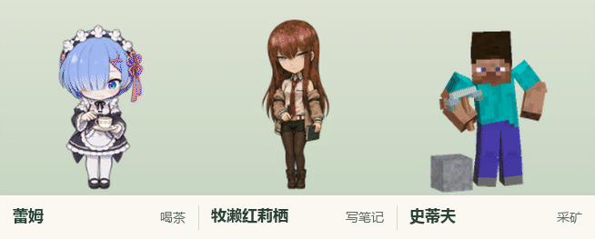

# 窗边手记

一个住在 Windows 桌面上的小伙伴。蕾姆会自己端起茶杯，牧濑红莉栖会翻开笔记本，史蒂夫会挥镐凿石、藏起绿宝石。你可以参与，也可以让他们自己玩到收场。



## 下载便携版

在[最新发行版](https://github.com/XiaoLiZiREAL/desk-atelier/releases/latest)下载 Windows 便携 ZIP，解压后双击 **窗边手记.exe**。首次启动会在桌面右下角遇见蕾姆，右击小人 → **伙伴设置 → 史蒂夫** 即可换成 Minecraft Java 版 1.8 的经典宽臂史蒂夫。支持 Windows 10 1809 及以后版本、Windows 11，需要 .NET Framework 4.8 或更新版本。

右击小人可以打开浅色工具菜单。点击桌面或其他应用即可收起工具卡，番茄钟和歌词继续运行。编辑便签时也可以暂时点出去，回来接着写。

## 陪伴与工具

- **日常活动**按角色和时间自动触发。打开后等一会儿，就能看到第一段动作。小盒子出现时可以猜一猜，继续忙自己的事也会自行揭晓。
- **番茄钟、便签与提醒**在右键菜单。把一段文字拖到小人身上可以记便签，把“10分钟后提醒我拿外卖”拖过去可以设提醒。
- **随身背包**会在你第一次把文件拖给小人时出现在身旁。点击背包可以打开收藏的文件、文件夹和网址。移出最后一项，背包就收起来。文件保存在原来的位置。
- **生活手记**藏在小人右脚旁露出的纸签里。点击纸签可以逐页读伙伴的日常，每次翻页都会随机换成另一种纸色，颜色有黄、蓝、红三种。
- **跟唱字幕**会随播放进度更新。右击 → **听音乐**可体验 18 秒内置演示，也可以导入 LRC。桌宠优先识别网易云音乐、QQ 音乐和酷狗音乐。媒体会话的播放、暂停与跳转已在 Windows 上验证，三个客户端的识别路径使用模拟窗口测试，具体版本的可读信息会有差异。在线歌词匹配可自行开启。


## 构建和运行

在 Windows PowerShell 或 PowerShell 7 中，从本目录运行以下命令。构建会使用本机的 .NET Framework C# 编译器，依赖均为系统组件。

```powershell
.\src\build.ps1 -Output .\build\DeskAtelier.exe
.\build\DeskAtelier.exe
```

编译后运行 `tests\run.ps1` 可检查紧凑工具卡、角色切换、存档、专注、房间、礼物和拖放。测试使用单独的数据目录，结果写到 `build\qa`。实际启动、右键和单实例唤回可以另用 `tests\LaunchSmoke.ps1 -Exe .\build\DeskAtelier.exe` 检查。`tests\run-dismissal.ps1` 使用真实鼠标输入检查浮层关闭，并从独立测试窗口将临时文件拖给桌宠。运行这项测试时需让出鼠标。

`tests\run-life.ps1` 从空白存档启动桌宠，观察第一段自主活动，验证关键姿势、藏物回应、无人参与后的收场，以及专注和安静模式的优先级。设计时使用的分镜和触发规则见 `桌宠动作设计规范.txt`。

在有交互式桌面的 Windows 中运行 `tests\run-music.ps1` 可测试跟唱。测试创建自己的本地媒体会话，并用带辅助功能标记的测试窗口检查播放器公开歌词的回退路径。默认输出在 `build\music-qa`。这类测试确认系统和桌宠之间的连接，具体客户端版本还需在装有对应播放器的电脑上验证。

## 实现

- `Studio.cs` 管理启动、单实例唤回、资源、角色反应与日志。
- `PetWindow.cs` 管理透明桌宠窗口、右键菜单、光标跟随、双人串门、全屏避让和托盘。`PetLife.cs` 编排专属动作、角色日常节奏、桌面小盒和主动活动的优先级。
- `StudioWindow.cs` 与 `Ui.cs` 提供贴近桌宠出现的工具卡、设置与控件。
- `Data.cs` 与 `ToolPages.cs` 提供专注计时、提醒、背包、拖入识别和原子存档。
- `RoomAndGifts.cs` 提供房间、收音机和礼物。
- `Companions.cs` 导入兼容的角色 ZIP，读取角色信息和动作图集。
- `WindowsMedia.cs` 和 `ChinesePlayers.cs` 读取系统媒体会话与三款国内播放器公开的窗口信息。`PlayerLyricOcr.cs` 提供可选的本地歌词窗文字识别。
- `ListeningRoom.cs` 管理歌曲切换、歌词匹配、暂停、校时和试听。`Lyrics.cs` 解析 LRC 时间轴并处理本地、缓存和可选的在线来源。`MusicPage.cs` 与 `KaraokeOverlay.cs` 提供听音乐卡片和桌面字幕。

## 素材

蕾姆与牧濑红莉栖的基础动作来自此前两套自定义桌宠，新的生活动作使用内置图像生成工具，以原角色形象为参照逐姿势绘制。每位角色各有喝茶、藏物、唱歌、写字和休息五组专属图集。美术制作要求为同一角色和服装、六幅清楚不同的全身动作、固定镜头、相同体型、脚底基准一致、手与道具在接触帧对齐。图集按实际运行尺寸保存于 `src/assets`。

史蒂夫使用 Java 版 1.8 原始 64 × 64 皮肤和经典宽臂方块模型。皮肤来源、校验值与用来生成关节动作的程序在 `art/steve`。桌边藏物、小屋和工具控件由 WPF 绘制，收音机内置曲目由程序合成。

生成史蒂夫素材需要 Python 3、Pillow 和 NumPy，可从源码根目录运行 `python art/steve/render_steve.py --out src/assets`。验证角色包可运行 `tests\run-actionpacks.ps1`，或通过 `-Pack` 指定随成品交付的史蒂夫角色 ZIP。检查包含基础包兼容、同包去重、替换动作后的独立收藏及异常图集尺寸。

听歌页的示范曲《窗边四句》为本项目生成的 18 秒原创器乐伴奏，包含四句原创演示字幕。程序优先使用播放器提供的当前歌词或用户选择的 LRC，曲库覆盖率与播放器向 Windows 公开的信息取决于外部来源。
