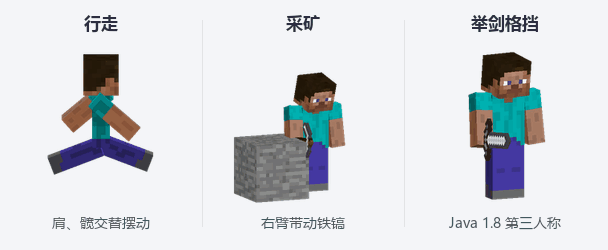

# Java 版 1.8 史蒂夫

使用 Minecraft Java Edition 1.8 正式版第三人称的经典宽臂 Steve。头部为 8 × 8 × 8，躯干为 8 × 12 × 4，四肢各为完整的 4 × 12 × 4 长方体。行走、潜行、转头、挥臂、持物、拉弓和举剑格挡共用同一套肩、髋枢轴和原始皮肤 UV。



## 皮肤来源

皮肤来自 Mojang 于 2014 年 9 月 2 日发布的 Minecraft Java Edition 1.8 正式版客户端。下载脚本先验证该版本元数据的 SHA-1，再验证客户端的长度及 SHA-1，只从归档中读取 `assets/minecraft/textures/entity/steve.png`。保存的 `skin.png` 是 64 × 64 的未修改 PNG。版本元数据与客户端的官方地址记录在 `origin.json`。

| 核验项 | 摘要 |
| --- | --- |
| 版本元数据 SHA-1 | `9eb165eef46294062d8698c8a78e8ac914949e7a` |
| 客户端 SHA-1 | `d722504db9de2b47f46cc592b8528446272ae648` |
| 皮肤 SHA-1 | `641094577ee247344afbfd7df3bd01e8b291a5a7` |
| 皮肤 SHA-256 | `4c7b0468044bfecacc43d00a3a69335a834b73937688292c20d3988cae58248d` |

## 离线重绘

需要 Python 3、NumPy 和 Pillow。从素材源目录执行以下命令，并将输出目录设为项目的 `assets` 文件夹。

```powershell
python render_steve.py --out .\assets --qa .\qa
```

离线重绘读取目录中的 `skin.png`、`items/` 和 `poses-1.8.txt`。从仓库根目录运行 `python tests/check-classic-rig.py`，可逐帧核对发行图集、姿态和裁切边界。

动作输入记录在 `classic_scenes.py`。从 1.8 客户端的 `ModelBiped` 得到六个部件各自的位置和欧拉角，再按第三人称模型的旋转顺序逐面绘制。`ModelPlayer` 的宽臂版沿用这一组姿势。拿在右手的物品使用该版物品模型中的 `thirdperson` 参数和像素贴图。钓鱼、垫块与递便签的分镜和停顿是桌宠的编排。听歌沿用原版待机摆臂，查看便签时手持纸张或地图。

基础图集是 1536 × 2288 的透明 PNG，包含九行动作和十六向注视。十九组场景图集各含六个 192 × 208 的透明帧，包括开垦播种、查看麦苗、收麦补种、拿放水瓶与铁镐和转身起步。农田与麦苗使用该版方块贴图。`--qa` 另生成动作对照图、基础图集预览和逐组 GIF。

如需修改分镜后重新采样，准备上表指纹对应的本地客户端、该版本清单中的运行库和 JDK，然后运行以下命令。采样程序直接调用原版模型并记录变换。普通桌宠用户只需要 Windows 便携版。

```powershell
python sample_classic.py --client <1.8客户端.jar> --libraries <运行库JAR目录> --jdk-bin <JDK的bin目录>
```
